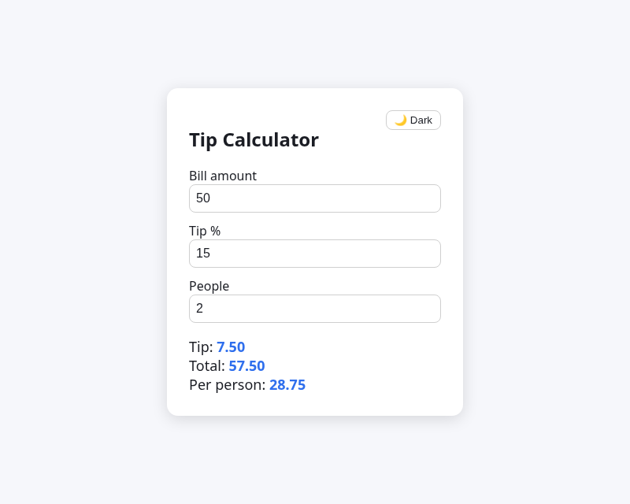

# GHW Hacktoberfest 2026

Built with an AI assistant (Grok Bot) during MLH Global Hack Week: Hacktoberfest 2026 (Oct 9–15, 2026).

## Tip calculator
A single page (`index.html` + `app.js`, no dependencies) that computes tip, total, and per-person split as you type. It has a dark mode toggle that is remembered in localStorage and defaults to your system preference.

Run it: open `index.html` in a browser, or use the GitHub Pages link in the repo About section.

## Challenge deliverables
- `challenges/campus-opportunities.csv`: next 5 events from https://lu.ma/bangkok, checked 2026-10-11T17:01:57+07:00 ([screenshot](screens/c5-table.png))
- `challenges/local-events-skill.md`: reusable browser workflow skill ([screenshot](screens/c6-skill.png))
- `challenges/browser-workflow-run1.csv`: run 1 (Bangkok, "AI", Oct 11–17) returned "no matches"
- `challenges/browser-workflow-result.csv`: run 2 (Singapore, "AI", Oct 11–17) returned 5 events ([screenshot](screens/c6-run2.png))

All event data comes from public Luma pages and was read at the time shown. Events can change after that, so check the source before you go.
